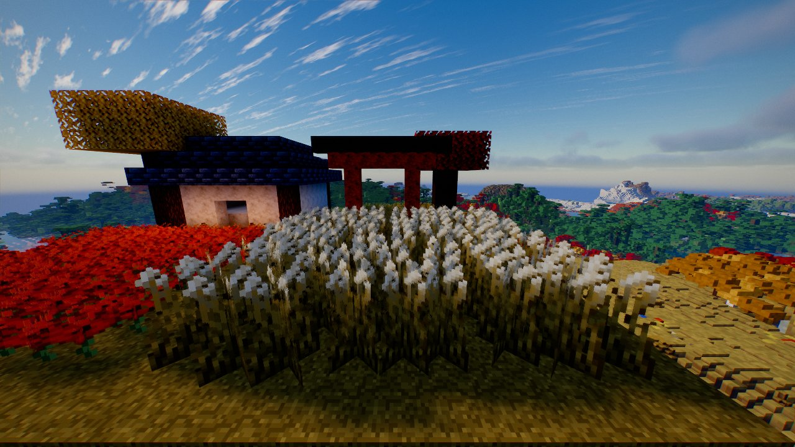
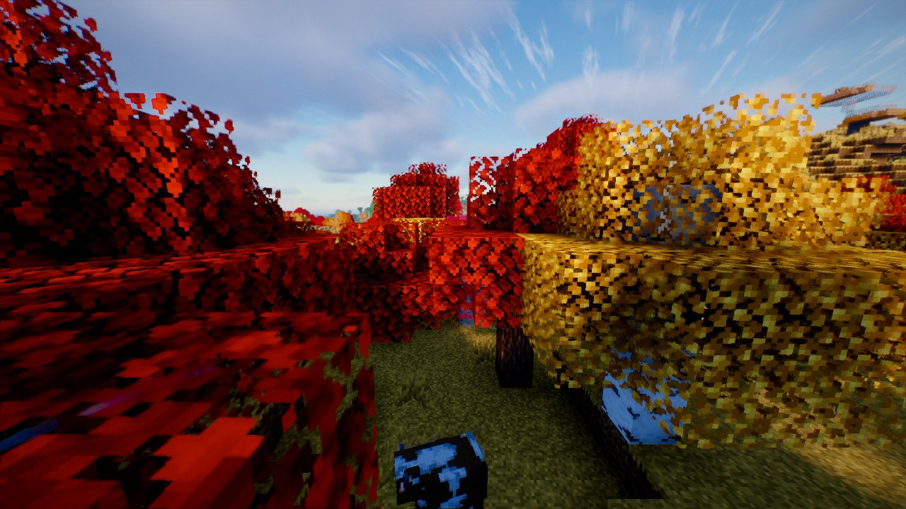
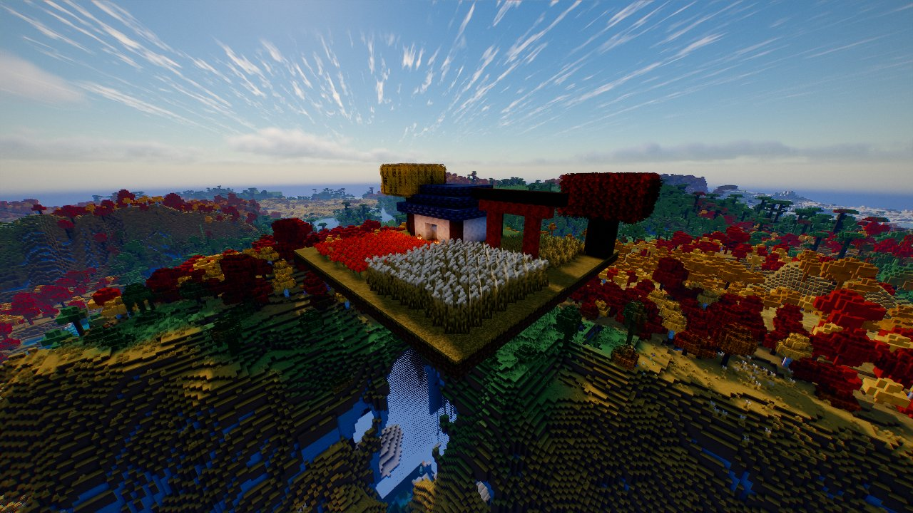
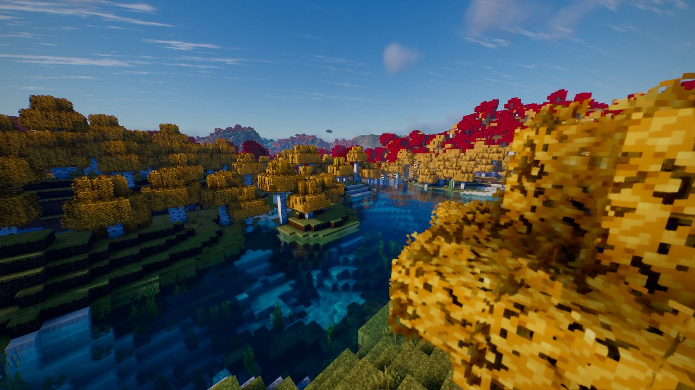
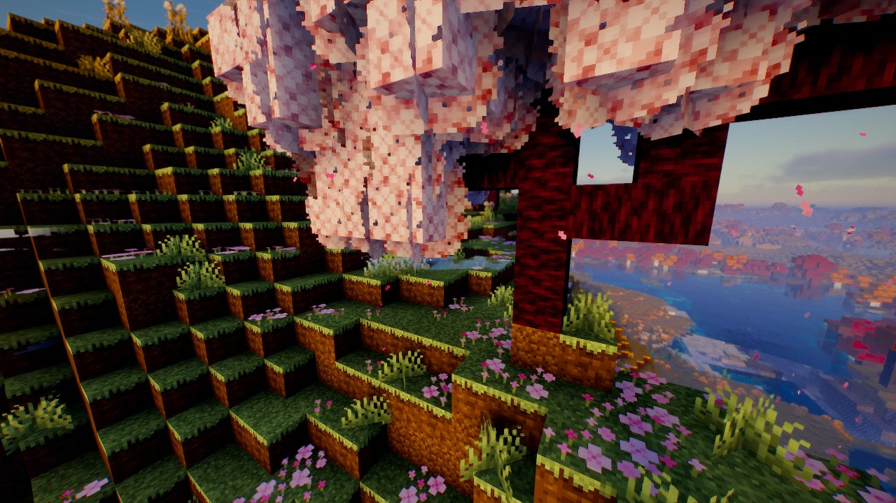
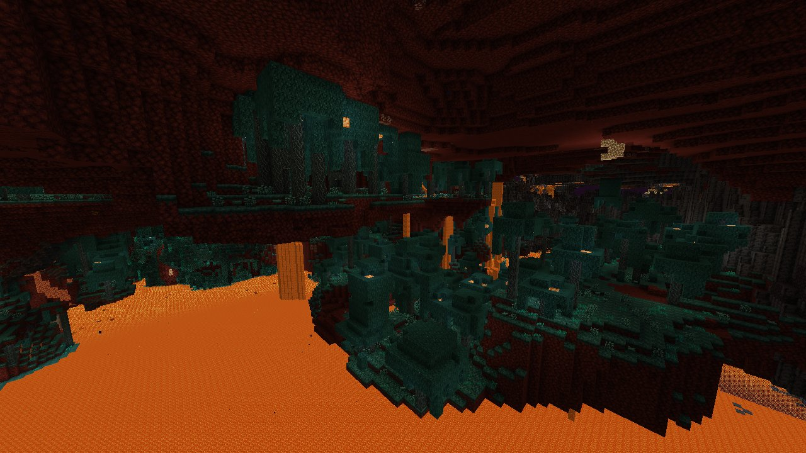
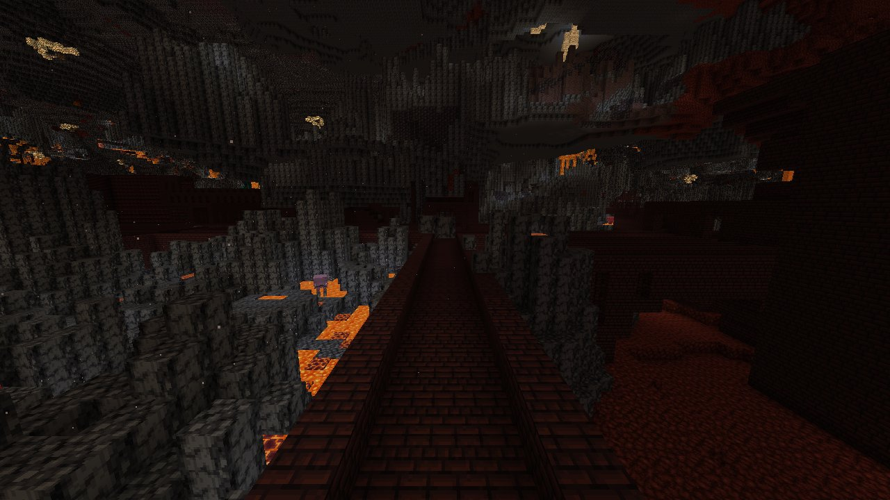
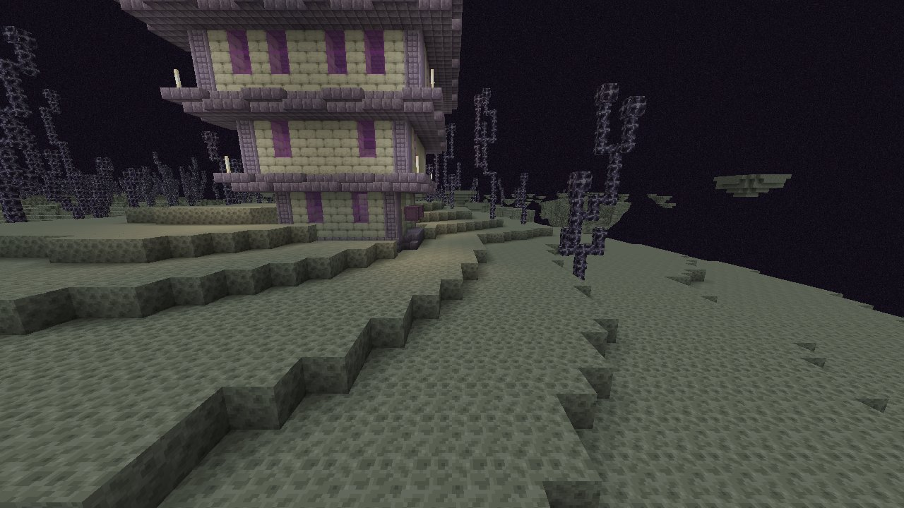

<div align="center">

# ChopzCinema – A tale from far east

**A Ghost of Tsushima–inspired resource pack for Minecraft 1.20.1**
built as the companion to the [ChopzCinema](https://github.com/ChopstickGuy/ChopzCinema) shader
and tuned for the **TruTopia** Forge modpack (Create, Distant Horizons and ~290 other mods).


 

</div>

## Features

**The Overworld**
- Biome-driven colour palette: golden *susuki* grass on plains and savannas, red maple forests,
  ginkgo-gold birch forests, fresh green meadows and cherry groves, dark cedar taigas
- Tall grass with pampas plumes, poppies redrawn as red spider lilies (*higanbana*),
  wisteria-flowering azaleas, denser and calmer bushy foliage
- Charcoal tree trunks, hinoki and dark temple woods, pale limestone, white beaches
- Japanese building materials while staying recognisable: kawara roof tiles (deepslate tiles),
  white plaster (white terracotta/concrete), shrine vermilion (red terracotta/concrete),
  shoji screens (white stained glass), thatch (hay), paper lanterns

**The Nether – *Yomi*, the underworld**
- Glowing volcanic rock, black-lacquered temple bricks, ash-grey soul valleys
- Crimson forests in higanbana red, warped forests as pale turquoise ghost woods

**The End – *Takamagahara*, the high plain of heaven**
- Moonlit pale end stone, lavender-ivory purpur temples, spirit-tree chorus plants

**Mods**
- Every block, item and armour texture of the TruTopia mods (~25,000 textures, including
  Create and all its add-ons) is graded into the same palette; Chipped variants reuse the
  palette of their vanilla block
- Create machines keep their crisp details and connected textures

<div align="center">
  
  
</div>

## How it works

The pack is **generated**, not hand-painted texture by texture. `scripts/build.py` reads the
vanilla and mod textures and

1. maps each block's luminance onto hand-picked, hue-shifted colour ramps (cool shadows,
   warm highlights) while keeping its pixel structure, so blocks stay recognisable,
2. reduces pixel noise for a calmer, painterly look,
3. writes biome colormaps, hand-drawn signature sprites (spider lily, pampas plume, wisteria,
   shoji) and the required block/item models,
4. grades all remaining vanilla and mod textures with a gentle Tsushima grade.

Optional modules:

| Script | What it does |
|---|---|
| `scripts/items.py` | Procedural 32x katanas and Japanese tool heads (tsuruhashi, ono, kama) whose fittings get richer with ore rarity |
| `scripts/armor3d.py` | 3D samurai armour (kabuto, crest, menpo, sode, kusazuri) via Entity Model Features `.jem` models |
| `scripts/spirits.py` | Re-grades your own copy of *Spirit's Samurai Gear* into the pack (not included, see below) |

## Building

Requirements: Python 3.10+, [`uv`](https://github.com/astral-sh/uv) (or pip), `curl`, `unzip`.

```bash
uv venv .venv && uv pip install --python .venv/bin/python pillow numpy
scripts/fetch_vanilla.sh             # vanilla 1.20.1 textures (or: scripts/fetch_vanilla.sh path/to/1.20.1.jar)
scripts/fetch_mods.sh                # optional: TruTopia mod textures
.venv/bin/python scripts/build.py    # -> "pack/ChopzCinema A tale from far east"
```

Flags: `--no-mods` skips the mod textures, `--no-spirits` ignores `ref/spirits`,
`--spirits <dir>` points to another copy of Spirit's Samurai Gear.

Then copy the folder (or a zip of it) into `.minecraft/resourcepacks` and put it **at the top**
of the list – above Better Leaves, Fancy Crops and the other TruTopia packs.

> **Why no download?** A built pack contains modified textures of Minecraft and of many
> third-party mods, which are not ours to redistribute. Build it yourself from your own
> game and mod files.

## Compatibility

- Minecraft 1.20.1, Forge 47 (TruTopia), Oculus + Embeddium
- Distant Horizons picks up the new colours automatically
- Bushy leaves are built in (based on Better Leaves), so the pack looks the same with or without it
- Best enjoyed with the [ChopzCinema](https://github.com/ChopstickGuy/ChopzCinema) shader

## Credits

- Inspired by the art direction of *Ghost of Tsushima* (Sucker Punch Productions) –
  this is an unofficial fan project
- Bushy leaf models: [Better Leaves](https://modrinth.com/resourcepack/better-leaves) by Motschen (MIT, see `third_party/betterleaves/LICENSE`)
- Armour and weapon art in private builds: *Spirit's Samurai Gear* by rikitikitivi – not included in this
  repository; supply your own copy in `ref/spirits` for personal use
- Not affiliated with Mojang Studios or Microsoft
